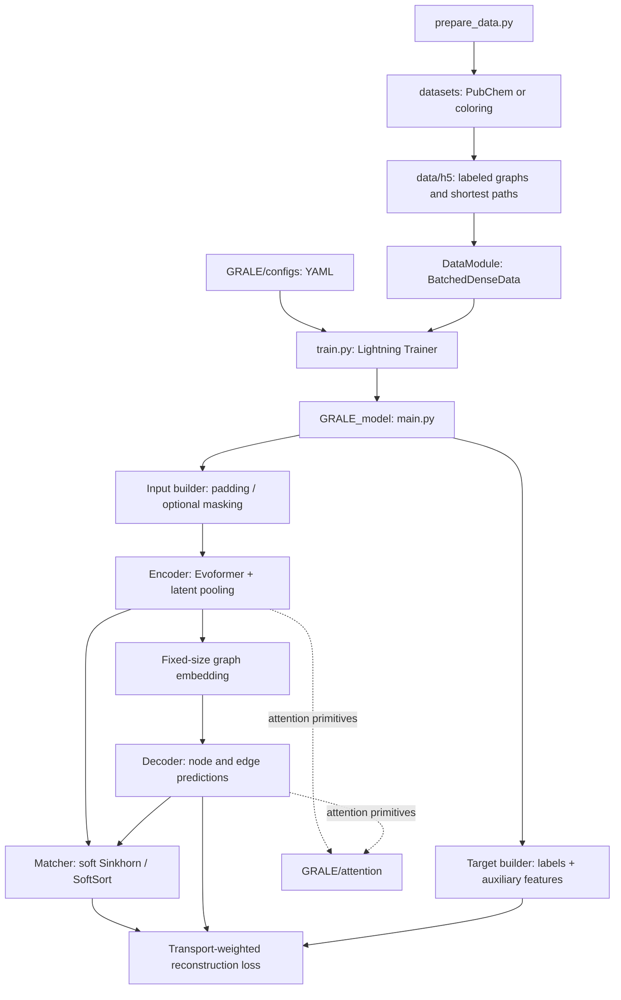

# GRALE project map

GRALE compresses a labeled graph into a fixed-size latent representation and reconstructs its nodes and edges. The [research record](research/overview.md) contains the method, datasets, agreed design and results; use this map to find the implementation. See also the [experiment plan](EXPERIMENT_PLAN.md) and [geometric run guide](GEOMETRIC_GRAPHS.md).

Code inspected at `7fc5cf3` (`main`), 2026-10-28. Paths below are relative to this repository.

## Reading route

[Demo](demo.ipynb) → [model orchestration](GRALE/main.py) → [encoder](GRALE/model/encoder.py) / [decoder](GRALE/model/decoder.py) → [matcher](GRALE/model/matcher.py) → [objective](GRALE/loss/objective.py). For training, begin with [train.py](train.py) and the [data module](GRALE/data/dataset.py).

## Pipeline and dependencies

The matcher uses encoder/decoder node embeddings to handle arbitrary node order. Training evaluates the loss under a soft assignment; validation uses a hard assignment. Standalone `decode(z)` needs only the latent representation.

## Where things live

| Path | Responsibility |
| --- | --- |
| [README.md](README.md), [GRALE.png](GRALE.png) | Upstream introduction, installation, architecture image. |
| [demo.ipynb](demo.ipynb) | Download pretrained weights; convert SMILES, reconstruct and visualize molecules. |
| [vizualization.ipynb](vizualization.ipynb) | Exploratory local-checkpoint evaluation and interpolation; contains older helper references. |
| [train.py](train.py) | CLI, YAML/checkpoint loading, GPU Trainer, logging and checkpoint selection. |
| [prepare_data.py](prepare_data.py), [prepare_data.sh](prepare_data.sh), [dev.py](dev.py) | Dataset preparation entry points; current Python default generates coloring datasets. |
| [datasets/molecules/](datasets/molecules/) | PubChem download, SMILES → graph conversion, vocabulary and size filters. |
| [datasets/coloring/](datasets/coloring/) | Synthetic colored-region graphs and generation settings. |
| [datasets/utils_h5.py](datasets/utils_h5.py) | HDF5 schema, split creation and appending arrays. |
| [GRALE/data/dense_data.py](GRALE/data/dense_data.py) | Graph containers, padding, batching, device transfer and permutations. |
| [GRALE/data/dataset.py](GRALE/data/dataset.py) | HDF5 → tensors; full-memory or rotating training chunks; fixed validation subset. |
| [GRALE/main.py](GRALE/main.py) | `GRALE_model`: train/validation steps, inference API and optimizer schedule. Also contains a minimal `GRALE` wrapper. |
| [GRALE/model/input_builder.py](GRALE/model/input_builder.py) | Pad inputs; optionally mask labels and incident edges. |
| [GRALE/model/target_builder.py](GRALE/model/target_builder.py) | Add neighbor-averaged node labels and normalized shortest-path targets. |
| [GRALE/model/encoder.py](GRALE/model/encoder.py) | Node/pair embeddings, Laplacian and shortest-path encodings, latent pooling; `evoformer` / `evoformer2`. |
| [GRALE/model/decoder.py](GRALE/model/decoder.py) | Latent → fixed node slots and pair predictions; `evoformer` / `evoformer2`. |
| [GRALE/model/matcher.py](GRALE/model/matcher.py) | Learned node alignment: Sinkhorn or SoftSort; hard Hungarian or sorting at evaluation. |
| [GRALE/model/utils.py](GRALE/model/utils.py), [GRALE/attention/](GRALE/attention/) | Embedding helpers, attention, node/pair updates and triangular operations. |
| [GRALE/loss/objective.py](GRALE/loss/objective.py) | Weighted reconstruction terms and logged validation metrics. |
| [GRALE/loss/](GRALE/loss/) | Linear node losses, quadratic pair losses, marginal regularization and assignment solvers. |
| [GRALE/configs/](GRALE/configs/) | Model/training YAMLs: molecules, coloring, bottleneck, masking and architecture variants. |
| [scripts/](scripts/) | Training launchers, including Jean Zay Slurm scripts with upstream account/environment settings. |
| [GRALE/vizualization/](GRALE/vizualization/) | Graph/molecule rendering and latent interpolation; spelling matches the source tree. |
| [research/overview.md](research/overview.md) | Consolidated method, dataset evidence, decisions and validation record. |

Generated `data/raw/`, `data/h5/`, `checkpoints/`, `logs/` and `wandb/` are excluded by the existing ignore rules; datasets and weights are not bundled.

## Data and inference contract

For batch size `B`, padded node capacity `N`, node-label count `Cn`, edge-label count `Ce`:

| Field | Shape / meaning |
| --- | --- |
| `h` | `[B, N]`; input `True` means a real node. Stored HDF5 `node_mask` uses the opposite convention. |
| `nodes.labels` | `[B, N, Cn]`; one-hot input labels. |
| `edges.labels` | `[B, N, N, Ce]`; one-hot labels, including class 0 for no edge. |
| `edges.adjacency`, `edges.SP` | `[B, N, N]`; binary adjacency and precomputed shortest paths. |
| Latent `z` | `[B, K, D]`; `K=graph_embedding_size`, `D=graph_embedding_dim`. Fixed per configuration, independent of actual graph size. |

See [HDF5 storage](datasets/utils_h5.py) and [tensor conversion](GRALE/data/dataset.py). The decoder emits `n_nodes_max` slots with existence scores; variable graph size is represented within this capacity.

| `GRALE_model` call | Behavior |
| --- | --- |
| `encode(data)` | Return graph latent only. |
| `decode(z, logits=False)` | Return graph predictions in decoder slot order; probabilities by default, without discretization. |
| `model(data, hard_matcher=True)` | Reconstruct and align outputs to input order; default `hard_matcher=False` uses soft alignment. |
| `canonical_permutation(data, hard_matcher=True)` | Return output-to-input alignment; invert it to reorder the input into decoder order. |

## Training and interpretation

- [train.py](train.py) accepts `--config`, `--dataset_path`, `--run_name` and optional `--checkpoint_path`. Config names omit `.yaml`; nested names such as `bottleneck/base` work. Launch from the repository root.
- Match dataset vocabulary and capacity to the YAML. [demo_checkpoint.yaml](GRALE/configs/demo_checkpoint.yaml) targets coloring (`16` slots, `4` node classes, `2` edge classes); [32.yaml](GRALE/configs/32.yaml) targets molecules (`32` slots, `32` node classes, `6` edge classes). A filename is not a dataset specification.
- Training uses GPU Lightning, AdamW, learning-rate warmup and cosine decay. It writes W&B/CSV logs and checkpoints selected by minimum validation `edit_graph`.
- In [GraphAutoencoderMetric](GRALE/loss/objective.py), `edit_graph` counts node-label errors plus half the ordered edge-label errors on real target nodes. `acc_graph` means zero such edits; existence and adjacency accuracy are separate metrics. This is not an exact graph-edit-distance solver.
- The repository provides training and validation orchestration, but no dedicated test CLI. Use [demo.ipynb](demo.ipynb) as the inference reference; the older visualization notebook includes a `graph_to_rdkit` import absent from the current plotting module.

This map describes the upstream source inspected at `7fc5cf3`; geometric additions and executed checks are documented in the [run guide](GEOMETRIC_GRAPHS.md) and [validation record](research/overview.md#validation). Paper results have not been reproduced.
