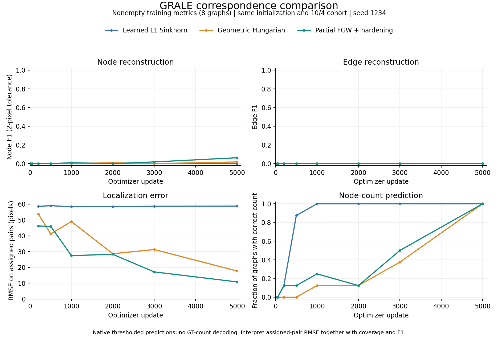
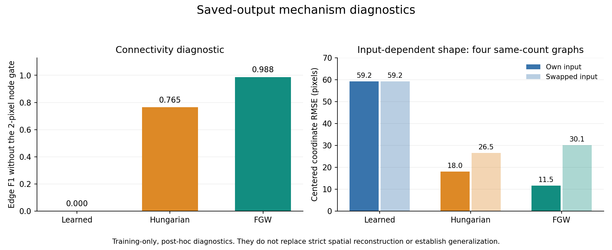

# Hungarian and FGW improve training, but precise reconstruction remains unresolved

The paired experiment supports replacing the learned transport for this tiny-fit
task. Hungarian escaped the centroid collapse; partial FGW further improved
training geometry and adjacency. This is a one-seed optimization result, not
evidence of reliable generalization. None of the models passed the strict tiny-fit
gate after 5,000 updates.

## Matched setting

Three fresh fits used the same seed, full initial-parameter hash, minibatch-order
hash, frozen 10-train/4-validation cohort, batch size 4, 64 slots, original decoder
initialization and reconstruction losses. There are 8 nonempty training graphs
(112 nodes, 81 edges) and 3 nonempty validation graphs (40 nodes, 27 edges); GT
graphs have at most 20 nodes. No anchors, resampling, test data or GT-count decoding.
All arms use LR 1e-4, 50-update warmup and cosine decay to the same 5k horizon.

Hungarian uses normalized XY L1 distance and node confidence, with weights 5/2.
FGW adds adjacency consistency at alpha .4, using the existing GNBM partial-FGW
implementation, 32 candidates containing every unary Hungarian match, feasible
unary initialization and global one-to-one hardening. Both recompute detached
assignments each pass; they are not fixed index correspondences. Coordinate
reconstruction still uses GRALE's original squared loss. Matching-cost details
and source provenance are in the [frozen plan](geometric-matcher-pilot-20261104.md).

Relative to learned Sinkhorn, this replacement changes cost, hardening and the
matching gradient path together. It does not isolate softness alone. The learned
control's entire aggregate snapshot sequence exactly reproduces the preceding
A100 initialization pilot, including initial weights and data-order hashes.

## Fixed 5k training endpoints

These primary metrics describe the eight nonempty training graphs. Every model
has correct counts and full assignment coverage, so RMSE covers all 112 nodes.

| Matcher | RMSE (px) | Node F1 at 2 px | Spatial edge F1 | Predicted edges | Median selected-node / GT spread |
|---|---:|---:|---:|---:|---:|
| Learned L1 Sinkhorn | 58.723 | 0 | 0 | 0 | 0.830% |
| Geometric Hungarian | 17.762 | 0.017857 | 0 | 68 | 93.720% |
| Partial FGW + hardening | 10.872 | 0.062500 | 0 | 81 | 96.878% |

Hungarian reduces RMSE by **69.8%** versus learned Sinkhorn. FGW reduces it by
**81.5%** versus learned Sinkhorn and **38.8%** versus Hungarian. Only 0/2/7 of
the 112 nodes respectively are within the strict 2-pixel tolerance. Exact
nonempty reconstruction is zero for every model; all empty graphs are correct
in both splits. Hard plans are sharp by construction, so their unit assignment
concentration is not evidence that the network learned anything.

## Connectivity is learning despite coordinate error

Strict spatial edge F1 requires both endpoints to be correctly localized within
2 px, explaining why it remains zero even when edges are emitted. A post-hoc
readback therefore also measures adjacency after unrestricted Euclidean
one-to-one node matching. This mapping uses positions, not GT adjacency or the
FGW training assignment. It deliberately ignores the 2-pixel localization gate
and is a supplementary connectivity diagnostic, not spatial reconstruction.

| Matcher | Edge TP | Edge FP | Edge FN | Connectivity F1 without localization gate |
|---|---:|---:|---:|---:|
| Learned | 0 | 0 | 81 | 0 |
| Hungarian | 57 | 11 | 24 | 0.765101 |
| FGW | 80 | 1 | 1 | 0.987654 |

Thus the FGW model learns almost all training adjacency under position-derived
correspondence, but its coordinates remain too inaccurate for strict spatial
edge correctness. Correct edge totals are insufficient: all GT training graphs
are acyclic, whereas one FGW training graph has a false cycle. Component-count
accuracy is 0/0.625/0.875 and cycle-count accuracy is 1/1/0.875 respectively.

## The geometry depends on the input graph

Broad output spread alone could reflect a common point template. To check this,
the readback cyclically swaps saved predictions between training graphs with
equal GT counts, in frozen manifest order. This yields four graphs from the
16-node and 20-node pairs. It requires no new inference: a different graph's
native prediction represents using that graph's encoded input. Counts remain
correct and coverage is 100% in every condition.

| Matcher | Own-input RMSE | Swapped-input RMSE | Own centered-shape RMSE | Swapped centered-shape RMSE |
|---|---:|---:|---:|---:|
| Learned | 59.18 | 64.93 | 59.18 | 59.15 |
| Hungarian | 18.25 | 40.80 | 18.02 | 26.49 |
| FGW | 11.55 | 43.67 | 11.53 | 30.12 |

Values are pixels. Separate centering removes centroid differences. The hard
matchers' worse swapped centered-shape errors support input-dependent shape
learning beyond counts/centroids; the learned model shows essentially no such
shape benefit. This is a post-hoc mechanism check on four training graphs,
not an independent generalization result.

## Validation and limits

| Matcher | Validation RMSE | Assignment coverage | Node F1 at 2 px | Spatial edge F1 | Connectivity F1 without localization gate |
|---|---:|---:|---:|---:|---:|
| Learned | 53.35 | 80.0% | 0 | 0 | 0 |
| Hungarian | 26.22 | 70.0% | 0.048193 | 0 | 0.057143 |
| FGW | 28.04 | 82.5% | 0 | 0 | 0.122449 |

All three validation count accuracies and exact reconstruction rates are zero.
Different coverage makes the RMSE values unsuitable as a standalone ranking.
FGW has no demonstrated strict validation advantage, and one validation graph
also has a cycle mismatch. The tiny held-out cohort and single seed cannot
establish systematic FGW superiority. No thresholds or settings were selected
from test data. The 5k cosine schedule differs from the original 200k horizon.

The useful next experiment is a longer **paired Hungarian/FGW tiny-fit test**,
with a common explicitly defined longer schedule, to determine whether the
remaining coordinate errors converge. Both should be retained: Hungarian is
the simpler control and FGW's training advantage is not yet a validation win.
A 5k checkpoint has finished its scheduler; resuming it with a changed horizon
must be documented as a new continuation stage, not treated as the original
long-horizon experiment. These longer runs have not been launched.

## Execution and reproducibility

- GPU pilot **1957335**: COMPLETED, exit 0:0, **31m00s**, one A100, four requested
  physical CPU cores (eight threads in Slurm accounting), 90-minute limit.
- Arm times including periodic evaluations/checkpoint/export work were
  603.95/569.61/594.04 seconds. FGW was about 4.3% slower than Hungarian on these
  small graphs. This is not a large-graph solver benchmark.
- All 15,000 log rows were finite and sequential; paired hashes and frozen source
  hashes passed. FGW emitted no solver warnings or silent fallbacks. Its matches
  differed from unary Hungarian for **6.482%** of training target assignments.
  All 11 nonempty endpoint solves met tolerance in one or two iterations.
- CPU export readback **1959587**: COMPLETED, exit 0:0, **1m03s**, one requested
  core, zero GPUs, five-minute limit. Strict counts reproduced every nonempty
  saved 5k endpoint; no model loading, inference, training or threshold tuning.
- Scientific source commit: `93433697ef0a656559a1bb8a5f5c06783282a814`;
  source archive SHA256
  `fa64df02639e3f6835d113043ae948b27dbb1a5f11549ee11e94a4a7692335f7`.
- Export-analyzer source SHA256:
  `c4267497fcf8fc591d04eadb728c88c2b5d2ef969956e37a6dcd766441dfb254`.
- The existing GRALE venv/module stack stayed unchanged. POT 0.9.7 lives in the
  isolated SCRATCH extension, whose copied package hashes passed preflight.
- Core training/validation/forward/canonical APIs use checkpointed
  `loss_assignment`. The learned matcher parameters are preserved for identical
  initialization but bypassed in the hard arms. Local analytic, finite-backward,
  checkpoint-reload and API-consistency checks passed before deployment.

Source: `$WORK/projects/GRALE-geometric-matchers-20261104`.
Results: `$WORK/experiments/grale-geometric-matchers-20261104/paired-5000`.
Images: `<results>/<learned|hungarian|fgw>/snapshots/step-005000/*.png`.
Each endpoint has three fixed example figures and all 14 native prediction/plan
arrays; FGW additionally has all 14 pre-hardening couplings and candidate lists.
This uses the new pilot schema and its saved diagnostics, rather than the legacy
200k-run inspection launcher. Checkpoints are `<results>/<method>/last.ckpt`.
Logs are `$WORK/logs/grale/grale-matchers-1957335.{out,err}` and
`grale-match-read-1959587.{out,err}`. The experiment parent preserves submission,
package/source provenance, aggregate summary and full export readback.

The original prepared ZIP remains unavailable. The same frozen GT inspection
arrays were reused, with strict hashes/identity checks and the preceding 14/14
old-checkpoint replay. No raw graphs, image figures or checkpoints left Jean Zay;
local artifacts contain aggregate results and solver/provenance metadata only.

[Primary aggregate JSON](results/geometric-matcher-pilot-20261104-summary.json) ·
[Diagnostic aggregate JSON](results/geometric-matcher-pilot-20261104-analysis.json) ·
[Primary vector figure](figures/geometric-matcher-pilot-20261104.svg) ·
[Diagnostic vector figure](figures/geometric-matcher-pilot-20261104-diagnostics.svg)
