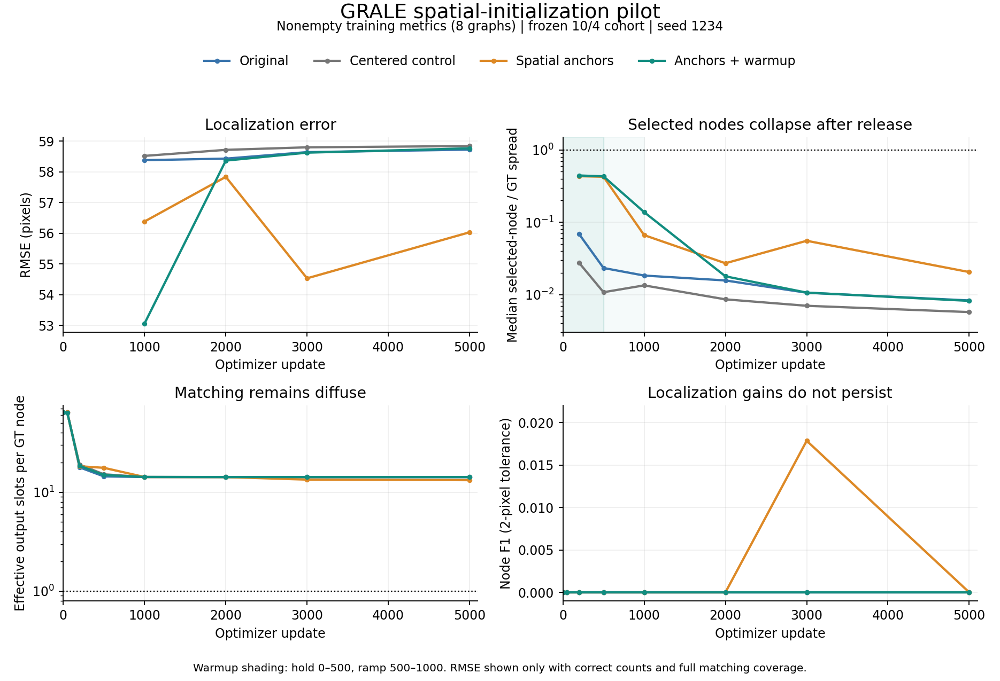

# Spatial initialization did not prevent reconstruction collapse in this pilot

Four paired 5,000-update fits completed on one A100. Spreading output coordinates
improved early spatial coverage, but the selected nodes returned to centroid or
group averages. A temporary coordinate hold did not prevent this after release.
Every final model had zero training and validation node/edge F1 and failed the
tiny-fit gate. This is evidence against initialization alone as the next fix
under these settings; it does not establish failure at every seed or budget.

## Controlled setting

The exact previous seed-1234 cohort was retained: 10 training/4 validation graphs,
including 8/3 nonempty graphs, with GT graphs limited to 20 nodes. Training has
112 real nodes and 81 undirected edges. Decoder capacity remains 64 slots.
All arms use learned L1 Sinkhorn matching, batch size 4 (4/4/2), original loss
weights, and the same shared initial parameter and minibatch-order hashes.
Centered/spread/warmup arms also have identical full initial parameter hashes;
their coordinate-anchor buffers and residual scales differ.

The common schedule uses LR 1e-4, 50-update warmup and cosine decay to 5,000.
These are fresh paired short fits, not resumptions or reproductions of the
original 200k schedule. Spatial anchors are fixed jittered points, one per 8x8
grid cell, with learned unrestricted offsets. The warmup arm uses residual scale
`clip((step - 1 - 500) / 500, 0, 1)` and is fully released at update 1001.
Anchors remain an additive slot-specific parameterization after release.

## Final results

Metrics below describe the eight nonempty training graphs. Count accuracy and
coordinate-assignment coverage are 100% in every arm, so endpoint training RMSE
uses all 112 GT nodes. Spread is RMS distance to each graph's own centroid;
the table reports the median predicted/GT spread ratio over these eight graphs.

| Arm | Train RMSE (px) | Node F1 | Edge F1 | Selected-node spread / GT | Graphs below 10% GT spread |
|---|---:|---:|---:|---:|---:|
| Original | 58.723 | 0 | 0 | 0.830% | 8/8 |
| Centered control | 58.839 | 0 | 0 | 0.573% | 8/8 |
| Spatial anchors | 56.032 | 0 | 0 | 2.049% | 6/8 |
| Anchors + warmup | 58.765 | 0 | 0 | 0.819% | 8/8 |

Every arm predicts zero of the 81 training edges. Empty graphs are reconstructed
exactly in both splits. Training nonempty exact reconstruction and component-count
accuracy are zero. Training cycle-count accuracy is one because these targets
and the edgeless predictions are acyclic; it is not evidence of reconstruction.

Validation node/edge F1 and node-count accuracy are zero in every arm. Validation
RMSE is 53.35/50.25/45.12/48.57 px respectively, but matching coverage differs
(80%/67.5%/80%/72.5%). Those partial-assignment RMSE values should not be read as
successful generalization or compared without their coverage/count failures.

[Aggregate JSON](results/spatial-anchor-pilot-20261104-summary.json) ·
[Vector figure](figures/spatial-anchor-pilot-20261104.svg)

## What the diagnostics show

The free-anchor arm initially maintains broad coverage. At 3k updates it briefly
localizes 2/112 nodes within the 2-pixel tolerance, but that gain disappears by
5k. Its 6- and 8-node graphs regain substantial spread without correct individual
locations. Most other graphs remain tightly clustered. After the warmup release,
the warmup arm's training RMSE rises from 53.06 px at update 1000 to 58.37 px at
2000 and 58.77 px at 5000.

Global slot spread is misleading: the anchor arms end with all-slot spreads
around 48–50 px while their selected-node median spread is below 3% of GT.
Inactive slots can stay distributed even when reconstructed nodes collapse.

Matching remains diffuse: effective output slots per target average
14.237/14.236/13.248/14.236 for original/center/spread/warmup. One-to-one matching
would approach one. Mean maximum assignment weight is
0.0841/0.0844/0.1450/0.0845. The mean `1/n_real` reference for uniform assignment
over exactly n_real slots is 0.08393, useful once correct counts are learned.
Predictions are close to their transport-weighted target averages: mass-weighted
residual RMSE is 0.65/0.39/2.66/1.91 px, despite localization errors around 56–59 px.

For a fixed soft transport matrix, the coordinate squared-loss minimizer is
`y_i = sum_j T_ij * x_j / sum_j T_ij`, summing over real targets. Diffuse rows
therefore favor averages. Spatial initialization changes the starting coordinates
but does not remove that optimum once offsets are free. The observed diagnostics
support this averaging mechanism; they do not isolate every cause of diffuse T.

The next controlled change should address correspondence directly, for example
adding an explicit predicted-XY/GT-XY distance term to the matching cost while
retaining learned matching. Mask coordinate cost on padded targets. Separately
audit cost normalization and effective Sinkhorn temperature. These are proposed
follow-ups, not changes made in this experiment. A longer initialization-only
run is not supported as the first next step by these results.

## Execution and provenance

- Pilot job **1952925**: COMPLETED, exit 0:0, **41m24s**, one A100, four requested
  physical CPU cores (Slurm accounting reports eight CPU threads).
- All four CSVs contain exactly 5,000 sequential finite log rows; checkpoints
  and final snapshots exist, and all paired-weight/order assertions passed.
- Scientific source commit: `41d18afe61dd01d365b1ea8d41dac539e83f4442`;
  archive SHA256 `0b9023a345bdeb18fc8ceb9e63affa253baaba5b9e1ac42ccda0e52cc38ff696`.
- Frozen subset SHA256:
  `c199e3a4d18229b067a3b779c6f17df5941624a5a94c3d77a86cbedb6484ddec`.
- Remote source: `$WORK/projects/GRALE-spatial-anchor-recovery-20261104`.
- Remote results:
  `$WORK/experiments/grale-spatial-anchor-20261104/paired-5000-a100-recovered`.
- Individual images: `<results>/<arm>/snapshots/step-005000/*.png`, for
  `default`, `center`, `spread`, and `spread_warmup`. Every snapshot includes
  three fixed example figures; per-graph metrics and prediction arrays cover
  all 14 graphs. The result root also has `comparison.png`.
- Logs: `$WORK/logs/grale/grale-anchor-pilot-1952925.{out,err}`.

The original shared prepared directory had been removed. Its archive hash
remains unverified. Training inputs were recovered explicitly from the original
inspection's saved float32 GT nodes, simple edges and pixel metrics; no images,
curved paths, new crops, resampling or test data were used. A separate CPU replay,
job **1954449**, COMPLETED exit 0:0 in 45 seconds, reproduced all **14/14** saved
predictions of the original 200k checkpoint. The recovered report/artifact hashes
and replay provenance are retained remotely. Only aggregate results were copied
locally; raw graphs, images and checkpoints stayed on Jean Zay.

Earlier H100 job 1951843 was cancelled while pending with zero elapsed time.
A100 job 1952135 failed at source-archive validation before any training update
(69 seconds). Its records were preserved. See the
[full plan and recovery record](spatial-anchor-pilot-20261104.md).
